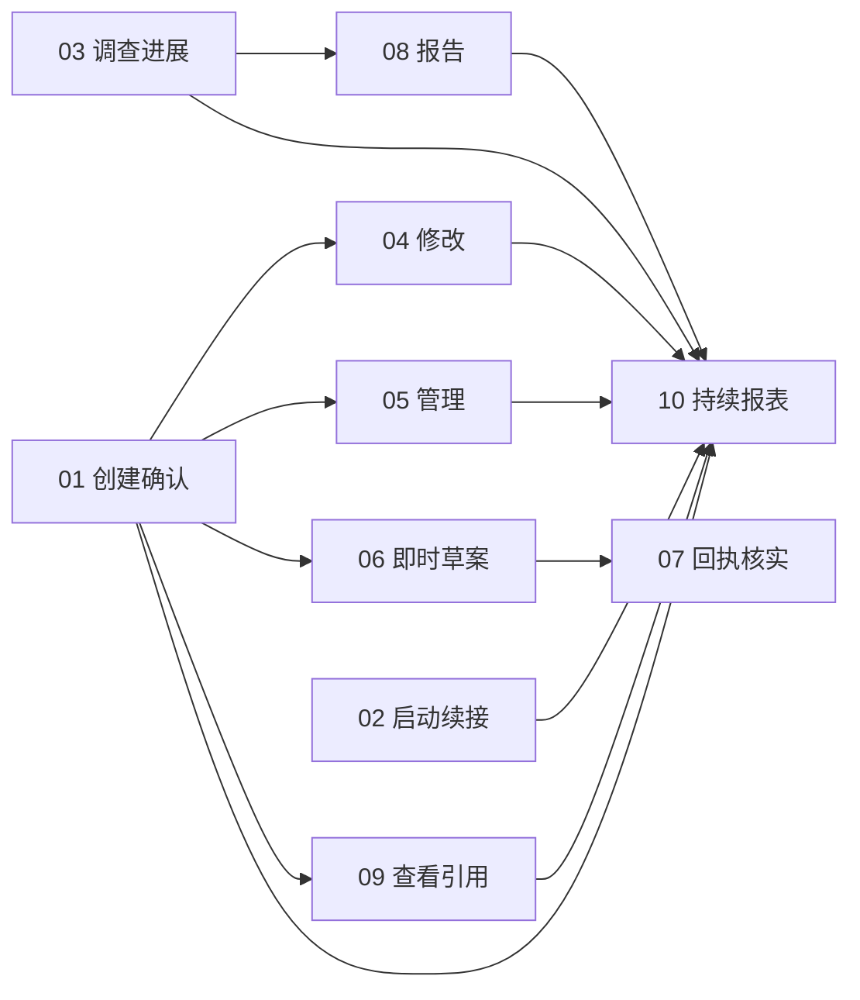

# 连续委托执行地图

**Status:** in-progress（2026-10-26 用户认可并授权推进；十票已发布，01首先实施）。

## 唯一入口与首个业务

先读[规格](spec.md)、[十票审阅](review.md)、[当前票正文](issues/01-create-confirmation-continuation.md)，再按[验收矩阵](acceptance.md)推进。首个业务是“创建确认错误→自动核实原操作→成功/必要决定/明确阻塞”。用户批准后十票已发布。01先只实现确认瞬态读取失败的原操作承接，再逐个覆盖必要分支；不得将十票视作十套恢复引擎。

## 基线和来源

2026-10-25 起草基线：MP f7a9ca3；Runtime f5fe8d1。起草前 MP 无未提交修改。Runtime 在同级独立仓库 `/Users/qianchen/works/新发展/iot-agent-runtime`，MP 为 `/Users/qianchen/works/新发展/mp`。后续开工前必须分别重新查 git status/log/diff，当前本文不是生产版本核验。

上轮生产记录 Runtime84c7d71，本轮未重新现场核验。Runtime f0ddd33/1f113de 的失败答复补充尚无最终生产发布证据；不能把更好报错当成自动承接完备。Runtime 原有未跟踪 `.scratch/agent-location-groups/`、`:memory:.sessions`、`apps/runtime/:memory:.sessions` 不属于本功能，不清理/提交。

设计依据：[设计审视](../../docs/research/2026-10-25-agent-continuation-design-audit.md)、[社区一手来源](../../docs/research/2026-10-25-agent-continuation-community-sources.md)、[反例记录](../../docs/research/agent-error-recovery-acceptance/continuation-audit-2026-10-25.json)。历史“应如何继续”由本规格细化为待批准票据，不反向修改旧证据结论。

## 测试与模块接缝

沿用既有已确认的 HTTP/NDJSON、会话恢复与微信业务入口，无新增私有测试接口。纯循环策略用现有 runner/provider 公开边界；故障注入在隔离网关/数据库副本，不在生产。模型负责决策、用户负责必要确认、Runtime确定性执行的领域边界不变。

源码导航（只在本地图维护，开工核对实际位置）：

| 业务 | 当前导航 |
| --- | --- |
| 消息入口、卡片确认/修改/管理、事件和恢复 | Runtime `apps/runtime/src/app.ts`、`apps/runtime/test/conversation.test.ts` |
| 模型工具循环、进展与停止 | Runtime `apps/runtime/src/agent/pi-runner.ts`；environment-history、mixed-scope-draft相关测试 |
| Task/Plan/发生、确认幂等与未来点 | Runtime `apps/runtime/src/tasks/`；相应store/plans/recurrence测试 |
| 统计准备、快照与报告 | Runtime energy-report-snapshot-agent相关实现/测试；复用现有报告持久化 |
| 客户端安全重放、原卡/草案/管理和恢复 | MP `apis/agent/index.js`、`pages/agent/components/AgentConversation.vue` 及其现有组件/状态模块 |
| 列表详情、收件箱报告与引用 | MP `pages/agent/` 现有任务/报告组件与引用入口；用rg核对现有公共交互 |
| 发布/编译 | `plan/2026-10-23-runtime-cloud-release-spec.md`、现有 package scripts 与 HBuilderX CLI |

三条红灯探针在 `../agent-error-recovery/probes/`（相对本目录），均是刻意失败的审视程序，不能当正常测试已过。它们从 Runtime 根运行 Node22 `--import tsx`，分别为 card-handoff.mts（加 `--expect-agent-handoff`）、progress-exit.mts（`--four`为绿对照）、entry-handoff.mts。实现时把业务断言迁入稳定回归，不直接依赖临时内部测试代码。

已有四条正确行为必须保留：新的成功读取后继续恢复；停止取消查询退避；不同参数连续修正；冷统计准备就绪同轮交付。具体测试名和旧结果见设计审视，不能固定旧测试总数作为当前通过数。

## 最小契约，首票内冻结

1. 原委托关联复用哪些当前会话/操作标识，如何在重开时读到目标、已完成事实和合法下一步。
2. 哪个公开恢复状态/事件表达处理中、必要等待、已交付或阻塞；旧客户端如何继续正确消费。
3. 相同原操作如何去重，系统恢复如何避免伪造用户消息/误退休卡，停止/新意图如何隔离迟到结果。
4. 权限/来源在哪次恢复重新校验；未知写只读核实；预算与进展记录复用现有机制，不叠加独立无限重试层。

这些是首个创建业务需要的实现决定，不另设“搭恢复底座”横向票。只在本票所需范围实现；后续票复用已证明的契约，不提前为所有场景扩展配置。

## 依赖图与实施顺序

建议一次一票按01→02→03→04→05→06→07→08→09→10实施，不新增语义阻塞边。共10票，当前全部未实施；规格与票据均已获用户认可。产品代码预估总量750–1420行左右（逐票上界为预警，不是需求或准确承诺），不含必要测试/证据；优先复用和删除重复路径。如首票需要广泛新状态机/队列，先回到业务收窄，不凭“统一架构”扩范围。

## 新旧票据承接

| 旧范围 | 本次承接 | 保留的边界 |
| --- | --- | --- |
| 旧01确认恢复/06会话恢复及创建等待补充 | 新01、02 | 保留幂等/过期重开/租约恢复/创建反馈；不重复宣称旧票没做 |
| 旧02/03工具纠错与无进展、04统计准备 | 新03、08 | 保留已有有界重试，新增真实进展/退出与报告完成条件 |
| 旧05管理错误、即时草案观察 | 新04–07 | 卡片错误成为原操作事实，需要推理时再进入模型 |
| 旧08验收与旧11失败答复 | 新09/10及逐票矩阵 | 保留局部证据，报错建议不是恢复完成 |
| 旧07物理证据、09旧整体门槛、10长停、13控制详情根因 | 不恢复为本轮阻塞 | 用户已移出；历史未验/未修事实保留，涉及恢复入口仍按新票处理 |

不关闭或修改旧父项。新票后续发现范围外问题只登记后续，不能把长停、控制物理证明或整个前端改版重新加成完成条件。

## 开发和关闭纪律

每票 /implement：先冻结当前单业务与代码量预期，/tdd 按外部行为红绿推进，必要时 /code-review 做 Standards/Spec 双轴窄审；不在草稿阶段假装已跑代码审查。真实推理验证沿既有 langfuse 规范使用可用追踪，未配置时记录同等脱敏轨迹，不为接观测系统另开主线。每票完成语义提交，在 plan/ 用 handoff 记录结果并引用现有证据，维护目录踩坑只在确有新经验时更新。

每个状态必须有事实依据：implemented-awaiting-acceptance 不等于 done，待发布不等于已发布。代理完成测试/真实模型/相关微信操作；票10完成既有生产规范下的最终发布和两次真实报表到期。无需微信上传提审；未经具体授权不做客户物理控制。及时清理自己创建的验收进程、隧道、库副本和只读计划，不动他人资源。
