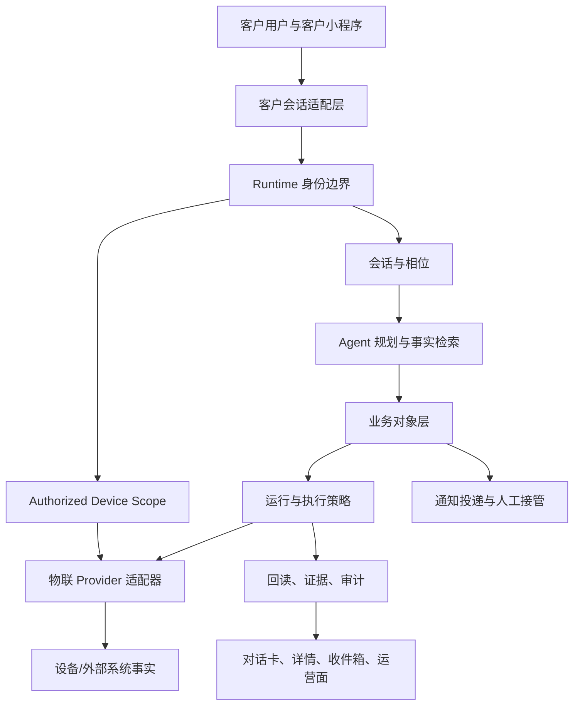

# 物联 Agent 系统全景地图

日期：2026-09-24
状态：规划地图，不是实现规格、排期或合同新增承诺

这张图回答四个问题：现在已经有什么，最终要形成什么，哪些业务可以下沉，哪些决定仍然挡在实现之前。它与 [Agent Expansion Wayfinder](../../.scratch/agent-expansion-wayfinder/map.md) 的关系是：本文件描述系统和对象，Wayfinder 描述必须按什么顺序做决定。

## 一、目的地

最终要交付的是一个**以客户真实用户为主体、以授权设备范围为边界、以证据和审计收口的物联 Agent**：

```text
客户用户登录
  -> 当前用户主体与工作空间明确
  -> 读取当前授权设备范围
  -> Agent 理解问题并提出事实、建议或操作草案
  -> Runtime 按当前权限、能力和风险策略重新核验
  -> 用户确认或已批准的自动化策略放行
  -> 设备执行、权威回读、结果收据和审计
  -> 对话、收件箱、详情或运营面继续处置
```

这不是“让模型可以调用更多接口”，也不是“先做一个通用工作流平台”。每轮只推进一个真实业务闭环；其他候选业务保留在地图上，不能自动变成当前承诺。

## 二、当前水位

| 状态 | 已确认事实 | 边界 |
| --- | --- | --- |
| 已落地 | 客户小程序是唯一生产 Agent 主线，复用客户登录态和园区上下文 | 独立 `agent-miniapp` 仅作回归、演示和复现壳 |
| 已落地 | 本机只有 `3200` 一个 Runtime，直连真实客户网关；缺关键配置即 fail closed | `trial/release` 仍需客户 HTTPS、合法域名和 NDJSON 代理验收 |
| 已落地 | 照明、空调、门禁已有“设备范围 -> 草案 -> 显式确认 -> 受理/执行 -> 回读/审计”底座 | 不等于门禁访客、门磁、消防或无人值守自动化已经完成 |
| 已落地 | 会话相位、单活草案、前沿检查、草案 TTL、终态补写、断流不取消已形成 Runtime 约束 | 这是会话和运行底座，不是长期自动化对象 |
| 已落地 | SQLite 持久化会话、轮次、事件、草案、候选集和审计 | 目前没有稳定 `principalId/workspaceId` 的长期业务归属 |
| 部分完成 | 视频、能源等已有接口和只读线索，按 E0-E5 分级 | 用户范围、事件/回放、数据新鲜度和验收证据仍按设备类型补齐 |
| 未开始 | 个人记忆、日程/会议、自动化规则、后台运行、告警收件箱、通知投递 | 在稳定主体、后台政策和设备支持包之前不进入实现 |

## 三、系统分层



各层的职责必须保持窄：

1. **客户会话适配层**只提供当前客户身份、工作空间和恢复能力；页面和模型不直接读取 Token。
2. **Runtime 身份边界**把稳定主体、工作空间和 Provider credential 分开。Token 只能是访问凭据，不能变成长久业务 owner。
3. **会话与相位**管理当前对话和一次运行的生命周期，不承载个人记忆或自动化规则。
4. **Authorized Device Scope**决定用户能看见和操作什么；Provider 全量目录不能越过它扩大范围。
5. **Agent 规划**可以检索、澄清和提出草案，但规划本身没有设备执行权。
6. **业务对象层**保存任务记录、检查点执行、告警、记忆等业务对象；这些对象不能藏在消息文本或模型上下文里。
7. **运行与执行策略**在每次副作用前检查当前授权、能力、版本、冲突、幂等和风险等级。
8. **证据与审计**区分“平台受理”“设备执行”“权威回读”“通知已投递”“用户已读”“告警已处置”。
9. **富操作面**只渲染结构化对象和状态，不凭视觉或模型文本猜测执行结果。

### 自动化层的独立边界

设备注册、Provider 能力适配和状态读取可以继续保持现有分层。任务执行不是第四种设备接口，也不是 Agent 的一个 Prompt，而是位于这些设备层之上的直接执行层：

```text
设备注册/台账
  -> 能力与 Provider 适配
  -> 当前状态/回读
  -> Task（统一任务：立即/延迟/区间）
  -> Task Phase（完整设备集合 + 目标状态）
  -> 直接读取全部设备并按需调用
  -> 回读、证据、审计
  -> Rich Surface Projection
     -> Agent 对话卡
     -> 区域公共面板
```

任务执行层可以调用设备层，设备层不能反向依赖对话卡或区域面板。任务保存区域、具体设备、目标状态和执行阶段；阶段结果与审计是任务记录的一部分。任务完成后可以不再生效，但对应记录仍可持久化。

首版不需要通用工作流。任务的 `effect` 只允许有限的业务类型，例如设备控制、只读巡检和报告产出。需要多步骤编排时，应先形成一个新的真实业务闭环，再扩展类型，而不是先抽象出任意步骤引擎。

## 四、对象和权威来源

| 对象 | 当前或未来含义 | 权威来源 | 应保存在哪里 | 不能替代它的东西 |
| --- | --- | --- | --- | --- |
| `Principal` | 客户确认的稳定用户主体 | 客户身份契约/客户网关 | Runtime 业务存储或客户侧主体映射 | `openid` 猜测、Token 哈希 |
| `Workspace` | 一个可管理的园区、楼层、办公区、会议室或办公室范围 | 客户小程序与客户系统 | 长期对象目标和运行上下文 | 当前用户的全部权限 |
| `Agent Working Scope` | 用户当前可访问的全部工作空间集合 | 客户系统授权 | 会话初始上下文 | 某次区域选择 |
| Provider credential | 访问物联上游的短期凭据 | 客户登录/Agent session | 进程内或安全凭据存储 | 业务对象 owner |
| `Authorized Device Scope` | 当前用户可见、可读、可控设备集合 | 客户 Office/工作区授权接口 | 每次读取、起草、确认和后台运行重新取得 | Provider 全量目录 |
| `Scope Selection` | 用户对 Agent 工作范围的多选关注集合 | 用户交互状态并结构化传给 Agent | 当前请求/会话上下文 | 授权本身或可见范围 |
| `Task` | 立即、延迟或有限区间内执行的一种统一业务对象 | Agent 规范化后的用户意图 | 任务记录/区域面板 | ActionDraft、AutomationTask 两套并列模型 |
| `Task Phase` | 任务在某一时刻需要达到的完整设备目标集合 | Task 本身 | Task 内部结构 | 一句自然语言动作 |
| `Task Execution Result` | 读取、按需调用和回读后的阶段结果 | 直接设备接口和回读 | Task 记录和审计 | Agent 再次规划 |
| `Region Operations Panel` | 区域任务卡片、运行结果、日志和 Agent 卡片的公共落点 | 区域业务对象 | 未来区域面板/查询接口 | 单个聊天窗口 |
| `Conversation` / `Turn` | 交互轨迹和一次模型运行 | Runtime | SQLite 当前表 | 长期记忆、规则 |
| `Rich Surface Projection` | 任务或运行在 Agent/区域面板中的结构化呈现 | 业务对象查询和服务端事件 | 客户端临时投影 | 模型生成的任意 JSON/HTML |
| `BusinessEvent` / `Alert` | 已发生且需要记录或处置的事件 | 设备平台或 Runtime 事实 | 未来事件/告警表 | Toast、推送消息 |
| `NotificationDelivery` | 向一个渠道投递的一次尝试 | 通知服务/渠道回执 | 未来投递表 | 告警状态、用户已读 |
| Memory object | 用户确认或允许保存的个人内容 | 用户操作或外部权威系统 | 未来分层记忆表 | 全量聊天记录、向量库 |

## 五、生命周期地图

### 1. 客户登录会话

```text
客户登录 -> sessionReady -> Agent 请求
        -> Token 过期/刷新 -> 保持同一稳定主体
        -> 区域选择变化   -> 更新 selection state，后续查询/操作带上选中区域
        -> 退出/换用户     -> 停止旧凭据，旧资源不可恢复
```

这一层由客户系统负责。Agent 默认接收用户可访问的全部工作空间；用户的多选区域状态作为结构化上下文传给 Agent，不改变授权范围。Agent 不重新实现微信登录，不把客户 Token 写入普通业务日志，也不能用当前 Token 哈希承载长期内容。

### 2. Agent 对话和运行

```text
idle
  -> running
  -> awaiting_confirmation
  -> executing
  -> idle

awaiting_confirmation -> cancelled / expired
executing             -> completed / failed / interrupted / unknown
```

约束：

- 用户下一条消息会终态化旧待确认草案；一轮只保留一个前沿草案。
- 客户端断流不等于服务端取消；服务端运行必须继续到终态或由显式停止收口。
- `phase` 是恢复时的权威；进程内 `activeRuns` 只是快速路径。
- 草案的 10 分钟 TTL 只适用于一次草案，不是用户、规则或设备授权的期限。

### 3. 统一任务生命周期

```text
用户输入
  -> Agent 识别区域、时间和设备目标
  -> Agent 找到具体设备并读取当前状态
  -> task proposal 富卡
  -> 用户确认，Task 进入区域面板
  -> 到达 Task Phase 时间
  -> 直接读取阶段中的全部设备
  -> 只对未达目标的设备调用并回读
  -> Task 完成；记录按保留策略继续存在
```

Agent 活动负责理解、澄清、找到设备和准备任务；到时执行是任务执行层的直接接口调用，不需要伪装成新的聊天轮次，也不重新调用 Agent。每个阶段读取任务保存的全部设备，记录观察状态、实际调用和回读证据。

任务状态描述它是否还会产生未来阶段，记录是否继续保存是另一个保留策略：

```text
Task: proposed -> confirmed -> scheduled -> executing -> completed
                                      ├──> partial | failed | cancelled | expired

Task Phase: pending -> reading -> applying -> verified
                              ├──> satisfied/no-op | partial | failed
```

真正的未来任务执行必须有稳定的执行身份。当前 Token 哈希 owner、创建者短期会话和开发身份覆盖都不足以支撑无人值守执行；缺少客户后台身份契约时，应降级为面板中的待执行任务或用户触发。

编辑遵循阶段边界：首个阶段执行前可以改整个任务；首个阶段完成后只能改尚未执行的后续阶段；任务完成或取消后历史只读，重新安排要创建新任务。这样任务版本记录的是未来行为的变化，阶段结果记录的是已经发生的事实。

### 4. 下沉业务的推演

| 业务 | 任务保存的意图 | 一次运行必须重新确认的事实 | 结束证据 |
| --- | --- | --- | --- |
| B01 会议空间准备 | 哪些会议区域、何时触发、准备哪些低风险设备 | 会议是否仍有效、区域当前设备、当前占用/例外、动作能力 | 每个设备回读和准备摘要 |
| B02 办公区开闭 | 区域工作日时段和照明动作 | 当前区域设备范围、同语义重复任务、加班/例外事实、设备状态 | 关灯结果和未执行原因 |
| B12 值班巡检 | 区域、巡检时间、检查项和报告格式 | 设备状态新鲜度、数据是否缺失、异常证据 | 巡检批次、异常项和证据链接 |
| B04 能耗报告 | 区域、统计周期和指标口径 | 计量点是否存在、数据时间范围、数据质量 | 带时间口径和数据质量的报告 |
| B08 消防/水浸事件 | 事件进入区域处置面板的规则 | 告警字段、责任边界、当前事件状态 | 事件/告警收据；高风险处置不能由普通任务静默完成 |

B02 反例尤其重要：三个用户都说“18:00 关灯”时，完全相同的意图应幂等归并为一次区域运行；“今天加班不要关灯”是冲突或例外，不应按最后创建者覆盖，也不应向设备重复发送三次命令。未解决的冲突进入面板并使对应运行 `blocked` 或 `skipped`，由区域内人员处理。

## 六、持久化边界

### 已有 Runtime 持久化

目前 SQLite 已覆盖：

- `conversations`：会话身份上下文和持久化 `phase`；
- `conversation_lifetimes`：短期会话 owner、最后活跃时间和清除状态；
- `conversation_turns`：用户输入、事件轨迹和终态；
- `action_drafts`：草案、选择、版本、过期时间和结果；
- `device_candidate_sets`：候选设备集、目录快照指纹和授权边界；
- `audit_events`：确认、取消、执行和其他审计事件；
- `discarded_session_entries`：会话历史清理记录。

这些表只负责当前 Agent 运行闭环，不能直接扩展成记忆、规则或告警总表。

### 未来需要独立的长期对象

```text
Principal / Workspace
  ├─ MemoryItem
  ├─ CalendarLink
  ├─ Task { phases[], execution results[], report, retention }
  ├─ BusinessEvent -> Alert -> NotificationDelivery
  └─ AuditRecord
```

任务是唯一的自动化业务对象；阶段、阶段结果和报告是任务内部结构。任务的生效生命周期和记录保留生命周期必须分开：任务可以 `completed`，记录仍然用于区域历史和审计。区域面板不需要成为第二份任务数据库，它可以是任务、报告和审计的查询投影。设备时间轴也从同一批任务结果和审计记录按设备投影，不建立另一套设备操作事实。具体存储表结构要在对应业务切片进入 `/to-spec` 后再冻结。

### 客户端只保留的状态

输入框、滚动位置、面板拖拽位移、动画代次、当前展开页、临时 loading 和未提交表单属于 UI 状态。它们不能作为服务端业务事实；页面重启后应从 Runtime 恢复对象和状态，而不是从视觉残留推断。

## 七、配置地图

配置按生命周期分四层，避免“改了文件但进程仍用旧值”或“体验版误用本地地址”：

| 配置层 | 例子 | 载体 | 规则 |
| --- | --- | --- | --- |
| 构建/环境路由 | `develop` 本机 `3200`，`trial/release` 客户 HTTPS | 小程序构建配置 | 精确按环境判断；`trial/release` 不回落本地 |
| Runtime 必填配置 | `MODEL_*`、`IOT_BASE_URL`、`DATABASE_PATH`、`PORT` | Runtime 环境 | 缺失或非法立即 fail closed |
| 开发身份 | `AGENT_DEV_IDENTITY` | gitignored 文件经启动脚本注入 | 只用于本地开发，不进入前端和长期对象 |
| 业务政策 | 草案 TTL、风险等级、人工闸门、通知升级 | 未来版本化策略 | 不能埋在 UI、Prompt 或临时环境变量中 |

当前真实网关的本地配置事实是：唯一活动 Runtime 为 `3200`，直连 `https://ncim.577119.com`；Iotfake、`3100`、`3201` 不属于当前架构。

## 八、记忆与个人内容地图

现在没有可以安全落地的“统一 memory”。后续应按信任和权威来源分层：

| 层 | 例子 | 默认写入 | 关键要求 |
| --- | --- | --- | --- |
| 用户档案 | 部门、常用地点 | 客户系统或用户明确填写 | 来源、修改、删除 |
| 长期偏好 | 常用温度、通知偏好 | 用户确认或显式设置 | 可解释、可覆盖、可撤回 |
| 事实记忆 | 某空间通常的使用习惯 | 低信任，默认不自动升级 | 来源、时间范围、置信度、纠正 |
| 会话摘要 | 上次讨论的上下文 | 按会话/用户设置保留 | 过期、可见、可删除 |
| 日程/任务 | 会议、提醒、待办 | 外部系统为权威 | Agent 只保存关联和偏好 |
| 临时运行状态 | 草案、运行、待处置告警 | Runtime 必须持久化 | 不得升级成长期记忆 |

记忆能力的前置条件是稳定 `Principal + Workspace`、用户可见的写入/删除入口和明确的外部权威来源。没有这些条件时，最安全的 Agent 是“可解释地使用当前会话和实时事实”，不是偷偷积累更多上下文。

## 九、工作范围、区域选择与公共面板

此前 Agent 的默认工作范围是用户可访问的全部工作空间。`district.id` 只是当前客户上下文中的一个字段，不能单独代表全部工作范围，也不能单独代表设备权限。

未来可以加入多选区域选择器：

```text
用户可访问的全部工作空间
  -> 默认 Agent 了解全部区域
  -> 用户选择“会议室 + 办公室”
  -> 选择变化作为结构化 selection state 传给 Agent
  -> 下一次查询或操作优先解释这些区域
```

选择器不是权限开关。用户仍然可以在对话中明确指定其他已授权区域；Runtime 在候选、草案、确认和执行时继续执行真实的 Authorized Device Scope 检查。

自动化的目标语义是区域，而不是创建任务的用户。首版区域公共面板至少需要展示：

- 区域任务的时间区间和下一次检查点；
- 开始/结束/指定时刻任务阶段的状态、最近结果和已知冲突说明；
- 区域时间轴上的任务报告、设备离线和部分完成说明；
- 编辑和删除入口；
- Agent 富交互卡片产生的任务、建议和结果链接；
- 与任务相关的设备操作日志和历史记录。

设备详情页可以显示设备自己的时间轴：每条记录来自任务执行或人工操作审计，包含时间、操作人或执行身份、来源任务、目标状态、实际结果和回读状态。区域时间轴和设备时间轴共享任务 ID、阶段 ID 和审计事实，只是观察角度不同。

拥有区域访问权限的用户可以看到和维护这些任务。首版不增加独立的区域角色矩阵；系统只继续执行已有的区域访问和设备控制校验。相同区域、相同动作和相同时间窗口的意图应避免重复创建或重复下发；冲突由 Agent 说明后交给用户决定。完整边界见 [ADR 0003](../adr/0003-shared-space-automation-boundary.md)。

### 富交互组件当前是否可靠

结论是：**当前链路只实现了设备任务的一种旧投影，不是统一任务模型。** Runtime 的 `action.proposed` 事件、`action_drafts` 表、`conversation.mjs` 的 `turn.draft` 和 `ActionPanel` 只能表达“现在确认后执行”的单阶段任务；它没有延迟时间、区间阶段、完整设备目标集合、区域任务记录或统一任务面板。

因此自动化不能通过让模型输出另一份任意 JSON 来“注册组件”。正确的链路是：

```text
Agent skill
  -> prepare task（模型只提供结构化意图和阶段目标）
  -> Runtime 校验区域、设备集合和目标状态
  -> 用户明确创建
  -> 持久化 Task 记录
  -> 服务端生成 task.created 投影
  -> 对话卡展示同一对象
  -> 区域面板按 taskId 查询同一任务记录
```

客户端只注册一个带版本的 `task` 富面类型，按照任务阶段数量和状态渲染立即、延迟或区间任务。富面操作必须带任务 ID 和版本回到服务端，未知类型不能动态加载组件，也不能由卡片本地“pin”出一个任务。现有 `ActionPanel` 只能作为单阶段任务的兼容渲染器，不能继续作为独立的领域对象。

当前真正需要继续讨论的只有执行政策：任务是否固定具体设备集合、前一阶段失败是否仍执行后一阶段、阶段之间的人工操作如何处理、开始后如何修改或取消、以及后台执行身份如何提供。任务模型、一次性范围、直接接口执行和统一任务卡已经不再是开放问题。

## 十、候选下沉业务地图

这些是候选业务，不是同时实施清单：

这些业务可以共享一个区域中心的业务面：Agent 负责自然语言入口和结构化建议，区域公共面板负责当前任务、检查点、待办、运行结果、告警和操作日志，也可以保留已完成记录的历史。不同业务只增加自己的对象和状态，不再为每个场景单独创造一套孤立入口。

| 区域业务族 | 可承载的下沉案例 | 面板中的对象与历史 | Agent 的作用 |
| --- | --- | --- | --- |
| 区域日程与任务 | B01 会议空间准备、B02 办公区开闭、B11 活动空间准备 | 区域任务、阶段、例外、下一次执行、结果记录 | 通过自然语言创建、解释、调整和生成任务草案 |
| 区域巡检与运营 | B12 值班巡检、设备状态汇总、失败运行复盘 | 巡检批次、异常项、证据链接、待办 | 汇总事实、解释异常、生成值班简报 |
| 区域能耗与舒适度 | B03 空间舒适度、B04 能耗报告、B05 异常用能 | 指标、读数快照、异常、报告任务 | 查询、比较、解释数据质量和形成分析建议 |
| 区域事件与告警 | B08 消防/水浸、B13 运行异常、B14 权限变化 | 事件、告警、处置状态、责任人、升级记录 | 事实核实、提出处置建议、驱动人工接管 |
| 区域设施协同 | B06 视频值班、B07 人数密度、B09 报修、B10 访客 | 设备关联、视频入口、工单、预约、审批 | 从对话定位事实并跳转到对应面板或创建业务对象 |
| 区域台账与审计 | 设备清单、控制记录、权限变化、操作日志 | 设备台账、能力、授权、审计记录 | 查询、解释、生成变更或处置草案 |

这意味着“公共面板”不是一个新的孤立产品，而是区域业务对象的共同管理面。第一条闭环可以只实现其中一个业务族，但对象身份、区域关联和日志跳转应从一开始保持一致。

| 组 | 候选 | 主要依赖 | 风险/范围判断 |
| --- | --- | --- | --- |
| 只读分析 | B04 能耗查询与经营报告、B05 异常用能复盘、B12 值班巡检与运营简报 | 能源/状态/事件数据、指标口径、证据汇总 | 可先做只读；不能把旧数据或估算当实时事实 |
| 低风险设备策略 | B01 会议空间准备、B02 办公区开闭、B03 空间舒适度、B11 活动空间准备 | 稳定主体、设备映射、日历/占用、动作白名单 | 每次运行仍需授权、冲突和回读；不默认无人值守 |
| 观察与协同 | B06 视频辅助值班、B07 人员数量和密度、B09 设备故障与报修、B10 访客到访 | 视频/人数/工单/访客接口和权限 | 不能从接口存在推断业务成熟度；视频回放和人数统计分别验收 |
| 高风险处置 | B08 烟感/燃气/水浸处置、B13 自动化运行异常接管、B14 权限变化下的运营 | 告警、责任人、通知、人工接管、审计 | 必须有人在环，不能只依赖小程序推送 |

选择某个 B 号只意味着选择一个 tracer bullet，不意味着删除其他方向或提前建设通用平台。

### 当前探索可行性（不是用户定稿）

| 候选切片 | 当前可行性 | 主要理由 | 仍然阻塞它的事实 |
| --- | --- | --- | --- |
| B12 值班巡检与运营简报 | 较高 | 可基于现有照明/空调/门禁状态、运行和审计做只读汇总，不产生物理副作用 | 稳定主体、值班范围、告警/通知是否纳入首片 |
| B06 视频辅助值班 | 中等 | 实时预览已实测可播放，入口可复用 WebView/H5 | 历史回放、事件关联、播放审计和用户范围细节 |
| B01/B02 低风险设备策略 | 中等 | 现有三类设备已有 E5 控制底座 | 稳定主体、触发器/例外、后台授权、冲突和回读策略 |
| B04 能耗查询与报告 | 中等偏低 | 目录、读数和统计路径存在 | 当前样本明显过旧，计量口径、区域层级和报表验收未冻结 |
| B08 消防/燃气/水浸处置 | 较低但价值高 | 有告警记录线索，业务价值和合同关联明确 | 字段语义、责任人、确认/关闭、通知、演练和人工接管契约 |

这张表只说明下一轮讨论的证据水位。它不替用户决定首个业务，也不意味着 B12 已被选中。

## 十二、决策路线

```text
P0 真实主体与 workspace 契约
  ├─ P1 设备支持包与 Authorized Device Scope（可并行）
  └─ P2 会话/长期运行的边界
          -> P3 执行模型与风险政策
              -> P4 富操作面、告警和通知政策
                  -> P5 选择一条业务闭环
                      -> /to-spec -> /to-tickets -> /implement
```

当前 Wayfinder 已有六张决策票，对应上述路线：身份、个人内容/记忆、设备扩展、执行风险、富操作面/通知、首条业务闭环。它们应继续以“决定”为完成标准；任何一张票未解决时，不提前实现其下游通用平台。

## 十三、现在不要做什么

- 不把候选 B01-B14 当作一期全量需求。
- 不先建通用自动化、通知或富组件平台。
- 不把会话事件表直接当作记忆、规则或告警表。
- 不用 Token 哈希、`openid` 或前端缓存冒充长期主体。
- 不用 Provider 全量目录扩大用户设备范围。
- 不把“接口能返回”写成“业务闭环已验收”。
- 不把模型回答、平台受理或推送成功写成设备已完成。

## 十四、下一次只需要回答的三个问题

1. 客户能否提供稳定 `principalId`、Token 刷新/撤销、园区切换和后台运行契约？
2. 下一批真实设备中，哪一种能提供完整的用户范围、状态/事件、控制/处置和验收材料？
3. 在这些前置事实具备后，第一条业务闭环要证明哪一种用户价值：只读运营、低风险设备策略、设备协同，还是告警接管？

这三个答案决定下一张规格，而不是现在就决定数据库、向量库、调度器或通知服务商。
