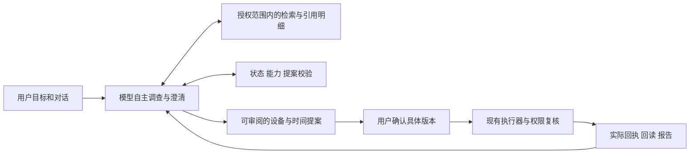

# 物联 Agent 设计审查：从编码智能体的证据循环回到真实业务

日期：2026-10-09。状态：调查结论与整改建议，**不是已实施规格**。

范围：优秀编码智能体的公开设计与源码、本项目模型循环、工具契约、提示词、持久化轨迹和验证方法。本轮不修改业务代码、不重启服务、不调用真实设备控制，也不创建 Langfuse 标注队列或替用户标注业务成功率。

基线：Runtime `b9c4031`，依赖 `@earendil-works/pi-agent-core@0.84.4`；小程序业务代码不参与本轮改造。小程序 `config/index.js` 的既有未提交修改保留。

## 核心判断

上一轮修复把可用性问题简化成了“限制重复调用，再要求模型记得候选”。这个方向没有解决模型怎样获得可行动证据、怎样纠正错误、怎样准确继承用户选择的问题，反而在部分路径上切断了恢复能力。

本项目已经有可用的通用 Agent loop、持久化历史、稳定候选句柄、授权复核、显式确认、后台快照执行、回读和报告。失败集中在模型与业务工具之间的契约，以及验证结论的可信度；没有证据要求推翻全部业务系统，或立即更换整个框架。

更具体的判断是：**模型被要求完成很自然的业务判断，但运行时交给它的检索结果不够可用，提示词与当前能力不一致，恢复过程又被次数规则提前终止。最后，验收把“生成卡片”当成了“正确理解用户”。**

## 外部设计究竟证明了什么

没有找到“优秀编码智能体在任意编码任务上接近 100% 成功”的证据。一次工具调用成功、最终运行正常退出、基准单次得分、重试后解决问题和实际用户满意度是不同指标。不能把编码产品的可恢复体验写成无条件成功率。

外部源码研究见[一手资料调查](2026-10-09-coding-agent-reliability-primary-sources.md)。本地也直接阅读了所安装 pi 的 `dist/agent-loop.js`：模型输出工具调用，执行结果作为带调用身份的消息进入上下文，工具结果之后继续调用模型；错误和中断有明确路径，`prepareNextTurn`、上下文转换、steering 等由宿主接入。这套基础循环本项目已经在使用。

[OpenAI 的 harness 说明](https://developers.openai.com/blog/codex-as-a-platform)把对话状态、工具执行、流式过程、审批、恢复与产品的业务数据/工具/同意边界分开。可借鉴的是职责边界，不能据此承诺换到 Codex 就会解决物联设备定位。

编码工具的实际优势是：搜索结果带文件位置，读文件可以继续取得原文，编辑有差异，编译和测试返回外部反馈。模型可以根据反馈改下一步，而不仅听取“不得犯错”的要求。物联场景应该提供同等可继续取证的能力：设备引用能读到完整名称和位置，查询结果能说明边界，提案错误能指向可修正字段，执行结果有实际回读。

| 设计点 | 应迁移到物联场景的做法 | 不能照搬的部分 |
|---|---|---|
| 通用循环 | 模型基于工具证据决定查询、澄清、提案或结束 | 用固定检索次数代替是否已解决业务问题 |
| 工具返回 | 结果有稳定引用、必要上下文和继续读取入口 | 只给少量名字，让模型猜剩余对象的位置 |
| 环境反馈 | 先验证提案，再把具体失败交还模型修正 | 真实设备动作不能像工作区编辑一样反复试错 |
| 上下文 | 保留当前目标、已取得证据、用户选择和业务对象状态 | 不能把摘要或历史授权当作当前授权 |
| 约束 | 确认、授权、动作范围和幂等由代码强制执行 | 不把每种口语都做成关键词分支或固定 workflow |
| 质量评估 | 检查最终业务结果和恢复能力，并做对照实验 | 假模型按脚本走完不能证明真实模型会理解 |

## 原始轨迹反驳了上一轮成功结论

本轮只读检查了 `var/real-runtime.sqlite` 和 `var/real-runtime.sqlite.sessions`，以 `mode=ro` 打开。证据是 Runtime 自己保存的业务事件、模型消息和候选集，不以历史会话总结替代原始记录。最小导出见[本地证据](agent-design-audit/2026-10-09-local-evidence.json)。这些是事故定向样本，不能计算生产总体成功率。

### A：真实失败中，指代对象并没有消失

会话 `7433d1a7-346e-4fd4-bc73-3756683670c3`：

1. 用户：“26楼办公区楼道的灯，5分钟后帮我开一下”。
2. 模型回复两组选项：“26楼前台01 过道灯带 / 过道射灯”与“2回路过道格栅灯”。
3. 用户：“后者”。
4. 第二轮第一个查询的 `deviceText` 就是“过道格栅灯”。这证明模型至少已经提取了后者的名称，不能把根因全部归为不懂指代。
5. 工具返回 81 台，`nameHintMatches` 明确命中 `d3_19`，但 `devices` 只有前 10 台，没有 `d3_19` 的名称/位置。
6. 接下来模型猜“26楼前台”、未来智城、农旅、数智工程研究院，查询数量为 `81 → 7 → 3 → 16 → 4`。
7. 约 57.9 秒后，无工具收尾给出空 assistant 内容，应用退回“本次检索没有继续产生新结果，请补充更具体的位置或设备类型”。

候选库中 `d3_19` 的完整名称实际是“照明开关-26楼运营部公共办公区过道-2回路过道格栅灯”。系统已经有这条记录，模型却没有正常得到可操作的完整明细。

该会话没有发生 compaction，上一轮 assistant 的两组选项仍在持久化模型消息中。因此“压缩造成失忆”和“上一轮选项没有保存”都不是本例已证明的根因。运行时收尾阶段新建的候选 Map 仅记录本轮经工具加载的集合，也不等于一份完整的会话业务记忆。

### B：所谓修复后对等复现并不对等

会话 `2a166df5-beaa-44ea-96e4-119bba1ac916`：

- 相同初始请求后，模型连续查询三次，回复是“最接近的是前台附近的过道灯具，我再缩小范围确认一下。请稍等”。该轮实际上已经 `run.completed`。
- 下一条“后者”之前，**没有两组选项**。
- 模型查询前台，然后为前台01过道灯带/射灯生成任务卡。
- 用户后来明确纠正：“这并不是办公区的”。模型承认定位错误。
- 再经用户“是第一个，50分的时候开启”的明确选择后，才为未来智城公共办公区生成另一张任务卡。

这证明了后来一次明确列表选择可以出提案卡，也证明前台提案不符合用户要的办公区；它没有证明原始“后者”场景被修好。不能把“两次工具调用、出现待确认卡”写成正确定位，更不能把原会话第二组选项和另一会话的前台提案拼成成功故事。

原先总结中的“真实二选一对等复现成功”应撤回为：**观察到另一条轨迹产生了任务提案，但对等性和目标正确性未通过；后续用户纠正确认了误定位。** 尚无证据表明这张错误提案实际执行，本轮不据此宣称发生错误物理控制。

## 源码层面的具体失败

下列路径相对 `/Users/qianchen/works/新发展/iot-agent-runtime`，行号对应 `b9c4031`。

### 1. 检索对象与返回对象脱节，是最先要修的契约问题

证据：`apps/runtime/src/iot/adapter.ts:644`、`apps/runtime/src/agent/pi-runner.ts:316`、`apps/runtime/src/agent/handles.ts:38`。

`deviceText/nameHints` 只计算软匹配，不过滤、不把命中设备排到明细前面。检索先按地点选设备，再取目录顺序的前 50 台，模型投影再取前 10 台。这个设计原本是为了保住范围，实际却让名称已经明确的目标不能被有效取回。

更严重的是投影引用不闭合：仍然保留前 50 台的 `nameHintMatches`，模型收到 `d3_19` 的命中，却无法读其名称、位置，也没有直接读取该引用明细的模型工具。数据库存在稳定 ID，并不表示模型拥有稳定可继续取证的接口。

同一结果的 `groups.locations` 在库里是 64 项，模型收到 40 项，但 `groups.complete` 仍是 `true`。提示词又要求只有 `groups.complete=true` 才可据此给完整概览。宿主缩减信息后没有重算完整性，模型因此被喂入了错误的覆盖声明。

整改方向：授权范围与搜索相关性分开；保留完整匹配依据，优先呈现真正命中的设备，并提供有界的引用明细/分页读取路径。任何引用必须可解析，任何截断必须诚实标记。不能用无限扩大上下文来掩盖工具缺口。

### 2. 把展示上限变成了操作资格

证据：`apps/runtime/src/domain.ts:65`、`apps/runtime/src/agent/pi-runner.ts:385`、`:515`。

只要一个候选集匹配超过 50 台，整集就禁止用于提案。哪怕用户只选中其中一台已经识别的真实设备，也必须重新检索出一个完整小集合。服务器保存的也只是前 50 台，不存在一个可以继续读取的全匹配对象。

“整层 81 台”由此变成了不断找更小地点的游戏；这并不来源于用户的真实业务决策。结果又被提示词要求“不要枚举子区域”，但没有替代的集合取证/分批提案能力，形成工具能力与行为要求的互相封堵。

整改方向：分别定义授权覆盖、检索结果完整性、模型展示分页、已明确目标、单次批准动作范围。维持真实控制的数量和确认边界，但允许从完整权威匹配中明确取得并验证用户选择的子集。整层请求若确实超出已批准的操作限制，应给有真实成员和覆盖信息的可审阅方案；不能静默取前 N 台，也不能伪称已有尚未支持的分批执行能力。

### 3. 计数守卫把有效取证误当成死循环

证据：`apps/runtime/src/agent/pi-runner.ts:287`、`:308`、`:680`、`:793`。

- 结果签名只有数量和设备 ID，忽略 `nameHintMatches`、位置解析、分组等信息。由“楼道”改为“过道”时，设备集合不变，软匹配证据却会变化；守卫仍吞掉新结果。
- 同类型查询计数没有因不同取证目的而区分，也没有每次遇到其他工具就重置；源码“连续”描述不能准确表达实际累计行为。
- 所有工具的相同参数第二次调用都能触发停用工具。状态刷新、失败后重试和重复读取任务可能有正当理由；该规则没有判断上次是否成功、结果是否新鲜、业务是否已变。
- 提案失败累计两次就撤掉工具，即使错误字段不同、模型正在逐项修正。

次数预算可以控制成本，但不能作为业务无进展的证明。建议保留总时间/调用预算和用户停止，移除未经行为评估验证的“次数=失败”业务判断。稳定纯查询可复用完整结果；瞬态错误按适配器重试政策处理；提案非法字段交还模型修正。不得重复执行的物理动作由执行层的确认身份和幂等承担，不能与只读取证混为一谈。

### 4. 提示词和实际工具能力已经分叉

证据：`apps/runtime/src/agent/pi-runner.ts:33`、`:54`、`:135`、`:276`、`:659`。

新增“后者/第二个”规则位于 Office `systemPrompt`，Company 选择的是另一个 `companySystemPrompt`，仅追加任务管理提示。保存配置 v2 的 Company/Office/回复附加指令均为空。这条正常推理阶段的规则没有应用到被宣称修复的 Company 场景；收尾阶段的 referenceReminder 才共用。

Company 基础提示和检索工具描述仍写智慧空调为主、不含视频，但实际 Company 目录和工具已接入照明、门禁、监控。Office 文本同时交织目录语义、设备参数、排版、提案生命周期和口语例子；长文本不是独立缺陷，**同一业务事实由多个位置维护且互相过时**才是问题。

此外，统一收尾摘要写“本轮候选仍然有效”，没有逐集携带原始完整性、解析质量和证据时间。已有来源校验应保留，但不能让新的文案摘要替代完整契约。

整改方向：核心指令只承担目标、证据原则、询问/提案/确认职责与不可越过的边界。设备能力以当前工具 schema 和权威能力结果为准；源能力由实际接入状态提供。去掉无必要的重复宣言和针对单次失败的例句堆叠，并对正常输入、收尾输入、恢复输入分别核对实际 payload。

### 5. 运行结束不等于解决用户问题

证据：`apps/runtime/src/agent/pi-runner.ts:701`、`:854`、`apps/runtime/src/app.ts:1268`。

应用已区分 `outcome=stopped` 与 `message`，这应继续保留。然而，模型收尾文字存在时，返回对象往往不携带 `stoppedReason`，因此某些被工具守卫终止的轮会被记为普通 `message`。B 的“请稍等”就是正常结束消息，用户却被告知仍会继续处理。

需要把主动澄清、已形成待确认提案、证据不足、预算中止和服务故障作为可辨识的运行结果。正常循环应允许模型自己判断已完成；资源截止的强制终止应如实表达当前停点，不许包装成任务成功。先核对现有结果字段，避免另建一套通用 workflow 引擎。

### 6. 测试和复测方向奖励了错误指标

证据：`apps/runtime/test/company-trajectory-recovery.test.ts`，对照 `apps/runtime/test/AGENTS.md`。

现有新测试用 faux model 明确编排固定工具调用，并断言第几次撤掉工具、提示词包含“候选集仍然有效”。它可以证明守卫确实执行、传输能够收尾，但不能证明真实模型会识别“后者”，更不能证明目标是用户所选设备。测试目录现行规范恰好要求不要锁提示词、调用顺序和内部次数。

应该保留能阻止越权、重复下发、确认前下发、假完成和无法收尾的工程测试。另用真实模型的有限业务评估检验目标集合、意图保留、正确澄清、时间语义和恢复。两类证据分别报告；测试通过数量不能替代业务可用性。

### 7. 模型能力尚未被对照隔离

本次健康端点返回 `GLM-5.3-Flash`。加密配置仅在本地内存解密，输出白名单字段：保存版本 v2、思考等级 low、每轮模型调用 6 次、工具调用 10 次、contextWindow 128000。未输出任何密钥；保存配置不单独证明每项参数在历史某个请求中的实际 provider 行为。

模型会误猜区域、过早承诺继续处理，也会在用户给出明确列表选择后正确形成提案。因此不能说一切只是 harness 的错，也不能断言换强模型必然解决。需要在相同目录夹具、相同输入历史、相同工具和预算下，对照当前模型与另一个已确认可用的模型；再做工具契约修正前后的对照，区分模型能力和运行环境影响。

## 回到业务：智能体应该替用户做什么

用户表达的是“这个办公区过道的灯，稍后打开”，不是“帮我把查询结果变成完整候选集”。模型应该负责理解位置与口语、比较真实设备、在缺关键信息时询问、形成完整目标和时间提案。运行时应该使这些判断有事实可查，而不是让用户代替系统维护查询术语。

下列结构是整改建议，复用既有模块，不要求创建全新平台：

- 对“后者”：让模型读到上一轮确切选项及其对象映射，必要时再取对应设备事实。允许为补足证据再次查询；不规定工具调用必须为零。如果只列了一个对象，就应澄清，不能猜一个对象生成提案。
- 对“整个楼层”：系统先取得真实完整集合/分组，再表达当前可批准的范围与限制。模型负责解释用户的范围，执行器负责安全分批；不能让模型靠十几次猜位置拼设备覆盖。
- 对“改到五点”：继承已引用 Task/Plan 和用户已明确的目标，读取权威版本后提出差异；重新确认改变后的内容。无需重新搜索全公司目录来重新解释已经确定的对象。
- 对“现在开了吗”：查询现态，并区分带时间的权威回读与无时间戳粗状态；查询失败或未核验不能借历史受理回答“已开”。
- 对未来任务：Agent 规划与确定性执行器继续分开。到时使用确认快照，不让模型再次解释设备和目标；周期历史和实际报告保持现有独立归属。

可持续的业务上下文至少要有当前讨论对象、用户已经确认的范围、仍待澄清的内容、权威业务对象状态和证据引用。大部分事实已经在现有历史/候选/Task 中，应先修复投影和读取路径。确有选项映射无法稳定保留的证据时，再增加小型结构化澄清记录；不要预建通用对话状态机、关键词消歧表或另一个规划器。

## 建议下一条推进闭环

只推进：**准确找到用户选择的办公区照明 → 保留多轮选择 → 形成正确的定时提案 → 用户可审阅；确认前零下发**。不把本轮扩大成框架迁移、全部设备重接、UI 重做或通用评估平台。

1. 冻结原始失败的设备事实、完整两组选项和预期第二组选中对象。加入“没有二选一则澄清”的反例，防止以错误目标出卡片取巧。
2. 修复检索相关性与引用闭合，明确截断后完整性，确保候选库已存在的目标能通过公共工具取得完整明细。不通过放宽授权/展示全部目录解决。
3. 恢复可修正的模型循环；保留成本预算、取消和所有真实执行边界，撤掉把有效取证当作无进展的计数条件。任何收尾说明须与真实运行状态一致。
4. 校正实际 Company/Office 工具契约和提示词事实，清理相互矛盾的描述。不能只把“后者”规则复制到另一个字符串然后宣布完成。
5. 从公开 HTTP/模型工具返回验证契约行为；以真实模型对相同业务变体重复评估。按结果选择是否更换模型，记录模型、prompt、工具版本、预算和实际目标。

建议的行为评估矩阵如下，属于待实施评估设计，不是已跑完结果：

| 情境 | 最窄可观察验收 |
|---|---|
| 原始二选一后“后者” | 提案目标只能是第二组的权威设备，时间/开灯目标保持；确认前无写操作 |
| 没有二选一却说“后者” | 问清对象；不自动创建某个猜测设备的提案 |
| 首轮匹配超出明细页且目标在页外 | 工具可取得目标名称、位置与稳定引用；无需猜其他办公室 |
| 同义词改变带来新软匹配 | 新匹配事实到达模型，不因设备集合相同被丢弃 |
| 目录撤权/旧引用失效 | 拒绝或重取当前授权；不能把持久化候选当永久控制权 |
| 参数或未来时间非法 | 返回可修正事实；合法修订可继续，历史/执行中对象不可改 |
| 真实预算用尽 | 保留已知对象和停点，诚实结束；不说“请稍等”后永久结束 |
| 下一轮纠正定位 | 尊重用户纠正，不自动继承/执行错误设备提案 |

主要指标是设备目标集合是否正确、未经确认写入是否为零、是否需要用户反复纠正、能否恢复至合法提案；延迟/调用成本是辅助指标。明确区分正确澄清和成功提案，既不奖励猜设备，也不以拒绝一切获得安全高分。调用次数少不自动表示更好。

建议先在协议夹具上跑真实模型，避免真实设备副作用；真实控制仍按具体场景单独授权验收。外部模型调用会有成本，实施前应按现有配置与用户授权范围确定实验规模，不在这份审查中宣称任何通过率。

## 验证边界与资料

- 已核对源码、安装的通用 loop、业务 SQLite、模型 session SQLite、健康端点和保存配置的非敏感字段。
- 两个重点会话均无 compaction；保存的原始历史包含此前消息。没有读取模型隐藏思考作为业务事实。
- 本轮未做新的真实模型实验；没有完整随机样本、对照实验或人类标注，不能归纳总体失败率，也不能量化各缺陷的因果贡献。
- Langfuse generation 层已有 systemPrompt/messages/toolNames 观测，下一轮可用于核对实际请求。根目录 AGENTS 已记录该实例读取可能滞后/缺行，所以本轮以本地持久化记录为主；未把 API 中查不到轨迹当作轨迹不存在。
- [Langfuse 错误分析指南](https://langfuse.com/guides/cookbook/error-analysis-llm-applications)：先读实际发生，再区分问题与根因；本轮没有执行它的完整人工标注流程，文中分类是工程审查意见。
- [外部编码智能体一手源码调查](2026-10-09-coding-agent-reliability-primary-sources.md)、[本地最小证据](agent-design-audit/2026-10-09-local-evidence.json)、[继续工作交接](../../plan/2026-10-09-agent-design-audit-handoff.md)。
