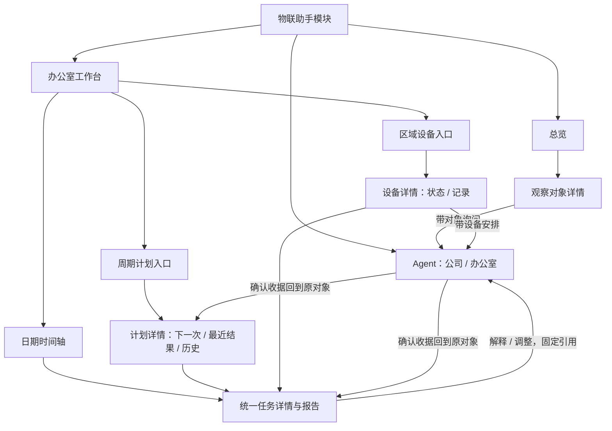

# 物联助手：页面结构与交互设计方向

> 后续说明：用户已明确先完整检查物联助手的全部导航，再确定预期体验。当前以 [完整导航检查](2026-10-07-page-navigation-audit.md) 为入口。本文的三个一级位置、新详情页与业务演练属于历史候选，不是批准的改造规格；对应业务原型暂停，不继续实施。

日期：2026-10-07。状态：设计建议，未批准为实现规格、未修改生产 UI、未做本轮视觉/真机验收。范围：物联助手及客户首页入口。事实底稿：[页面与导航核对](2026-10-07-page-navigation-audit.md)。依据：用户指出设计思考不足，以及 emil-design-eng 的空间一致性、默认行为、即时反馈、可中断动效与整体协调原则。

## 核心判断

当前界面把长期工作空间、业务对象详情、临时编辑混在聊天和 Sheet 里。用户进入一个设备后又进入某次任务，关闭抽屉却丢失整个路径；创建周期计划后，长期计划主要寄居在旧聊天收据里。单个控件已有按压反馈和细节打磨，但整体结构没有给用户稳定的位置感。

设计目标是让用户用“我在什么地方、正在看什么、接下来能做什么”理解产品。18 个界面状态需要组成清晰的层级，每一次位移、背景变化、返回行为都对应同一套层级。

## 建议的产品骨架

模块内三个稳定的一级位置：**总览 / Agent / 办公室工作台**。这是可供原型比较的主方案，不是已经决定采用底部 tab 的实现要求。客户原有服务首页仍是物联助手模块的外部入口。

| 位置 | 用户目的 | 内容与主动作 |
|---|---|---|
| 总览 | 知道公司现在怎样，哪些事实值得进一步看 | 保留公司观察与现有仪表盘方向；可点对象进入详情，或带当前对象问公司 Agent |
| Agent | 表达意图、解释结果、形成需要确认的操作 | 公司/办公室用可见的来源切换控制；当前来源常驻文字标识，各自保留对话、草稿和引用；切换不在页面栈中不断压入同一个聊天路由 |
| 办公室工作台 | 找到已安排的事、正在执行的事及历史结果 | 当前区域、日期时间轴、周期计划和设备有清晰入口；创建/修改仍交给 Office Agent，面板不扩成规则编辑器 |

来源切换与区域切换是两种语义：来源切换更换业务体系；区域选择修改 Office 默认地点。两者在标题、位置和文案上明确区分。Company 没有实现任务工作台，当前主方案不制造一个虚假的 Company 工作台；从 Company 切进办公室工作台时明确显示 Office 上下文。

工作台内，任务/计划与设备是可平级找到的业务入口；B6 保留为“按日期查看发生”的视图。周期计划提供长期可重访入口，它的下一次、最近结果和历史属于同一个计划。历史报告独立保存，不能由“现在选的区域/日期”决定是否可打开。

图为目标设计；引用、修改、周期管理及新详情路由包含尚未实现的能力。新增入口必须随着相应业务可用交付，不先放空菜单。

## 页面、Sheet 与卡片的职责

**页面承载长期阅读与可重访对象。** 设备、任务、计划详情应有稳定身份和直接入口。区域列表只提供浏览上下文，不能成为详情读取的先决条件。详情返回恢复进入前的筛选、日期和滚动位置；从外链进入则使用明确的业务归属兜底。

**Sheet 承载短时决策。** 选择区域、切换筛选、调整某个空调参数、查看小范围设备选择可以留在 Sheet。内部使用一个编辑区域，避免继续形成设备→记录→任务的长导航链。系统返回先收起短时层，再退详情页；遮罩/下拉关闭短时层不等于放弃业务草案，放弃必须有明确动作。

**聊天卡承载意图、确认与收据。** 正文、设备目标、主动作按阅读顺序流动。默认展示最必要的信息；较长设备集合显式展开。确认后原位成为创建收据，保留“下一次/最近结果”或“打开任务”。计划不依赖这张收据才能再次找到。

## 现状到建议的设计变化

| Before | After | Why |
|---|---|---|
| 头像菜单混合清除会话与跨模块导航 | 一级导航固定；会话菜单只放当前会话相关动作；Agent/来源名称可见 | 位置稳定，用户不必记住隐藏菜单；工作对象与破坏性动作分离 |
| Office/Company 每次切换 push 同一个聊天路由 | 同级来源就地切换，保留各自阅读位置、草稿与引用 | 同级关系不伪装成深入一层；“返回”不成为反复切来源 |
| 设备→设备记录→任务占用同一 90vh Sheet | 长期对象使用详情页面；短时选择/编辑使用 Sheet | 长篇阅读、历史、后续操作有足够空间，关闭动作不突然退出三层 |
| 聊天草案含固定 300px 内部滚动区、tab 与多层表面 | 卡片自然高度，摘要与主动作直接可见；长设备集合渐进展开 | 触摸滚动和阅读只有明确的一条主轴；减少卡内找内容和按钮 |
| 设备台账列表与草案设备列表含相似控件 | 前者标“区域设备”；后者标“本次操作 · 已选 n 台”，主按钮分别是“带设备询问”和“确认操作” | 相同设备视觉可以复用，但当前行为必须被辨认出来 |
| 总览观察关闭后进入空上下文对话 | 对象详情提供“问公司 Agent”，携带明确设备/记录引用，不自动发送 | 用户刚看到的事实成为接下来问题的上下文 |
| 任务报告底部只有来源编号和删除 | 按状态提供解释结果、调整未来部分、查看相关设备；取消注明本次/未来未执行部分 | 报告是下一步工作的起点，历史结果不会被后续操作重写 |
| 周期计划重访依赖原聊天卡 | 工作台可找到计划；计划详情贯通下一次、最近结果、历史及 Agent 管理入口 | 用户离开聊天几天后仍知道安排在哪里 |
| 几乎所有卡片都带纸面、描边、多层阴影 | 纸面用于内容底；玉绿强调当前可执行主动作；黄铜用于待注意结果；深度只表达层级 | 材质共同构成产品气质，同时让信息重要性有差异；正常状态颜色不制造紧迫感 |
| 抽屉关闭再打开时重播设备卡入场；筛选/搜索持续有较长位移动效 | 高频筛选/搜索立即反馈，列表不重播入场；少量明确层级变化保留位移 | 常用动作更轻，动画不反复收取用户等待成本 |

材料判断来自现有样式与结构，实际颜色、留白、字阶还需同屏原型验证；不宣称已凭源码完成视觉评审。

## 切换应怎样感觉

一级切换直接显示保存的内容，无水平 push，不重置滚动。进入详情从右侧深入，返回反向还原；用户仍能看见进入前对象的位置。短时 Sheet 从底部进入，遮罩跟随同一进度。按压先反馈，加载随后发生；动画不等待接口，失败留在当前对象提供重试/退出。

原型起始参数：按压 120–140ms / scale(.97)；详情 push/pop 220–260ms；Sheet 入场 240–280ms、退场 180–220ms；使用既有强 ease-out 与 drawer 曲线。高频分组/搜索和键盘操作即时响应；自动刷新更新事实，不重演页面进入。快速开关可以从当前进度反向，不靠固定 timer 禁止用户继续操作。

拖拽期间面板和遮罩同步跟手，松手用距离和方向/速度决定收起或回弹；多指不得改变起始触点。具体阈值由微信真机调试，不能照搬浏览器或 skill 的示例数值。保留现有本地 DeviceSheet 底座，先评估感受再决定是否改变手势。减少动态效果时保留必要状态提示，取消空间位移。

## 用真实意图检验整套设计

主场景：用户在 Office Agent 安排工作日关灯→核对计划与设备→确认→看到稳定创建收据→离开模块→几天后从工作台找到同一计划→打开这次发生→读报告→点“解释结果”带固定任务引用回 Office Agent→点“调整以后安排”得到明确作用域提案→确认→从收据返回同一计划。Agent 不自动发送引用，也不覆盖原输入草稿。

异常场景：提案放弃仍留在原轮；确认失败保留选择；加载详情失败保留目标身份与重试；权限变化诚实说明并提供返回；报告部分失败能够引用追问，后续操作与原执行记录分开；编辑时用户退出保留草稿但不提交。

已有草稿时，把引用追加为独立、可移除的对象条，不静默覆盖或消费新建意图。从报告进 Agent 时标明任务名称、发生日期和作用域；返回时恢复原报告与阅读位置。一级导航用于去另一个工作空间，“返回”只撤销一次深入。

原型验收至少覆盖：首次进入；二次重访；系统返回/遮罩/下拉各自作用；创建与放弃；报告追问；本次/周期作用域；来源切换和原草稿保留；加载中快速返回；空列表和权限变化；375/320 宽与真机手势。未实现业务在原型中显式标样例，不能当生产完成证据。

下一设计产物应是能走通上述路径的整套可操作原型：用现有拟物语言和 B6 表达新层级。原型优先验证“稳定一级位置 + 长期详情页面 + 短时 Sheet”这一主方案，再决定页面布局和具体导航控件。当前不冻结页面数量、不加入通用规则编辑器、不把修改/收件箱等缺失业务提前记为完成。
