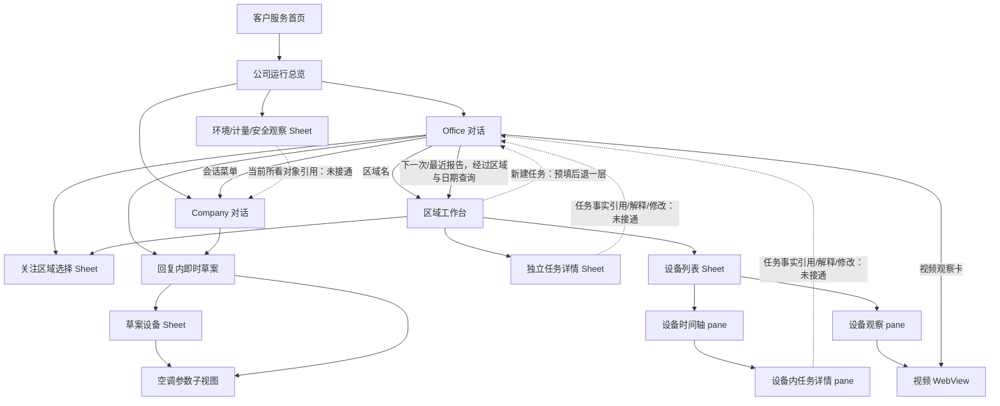

# 物联助手页面与导航现状核对

日期：2026-10-07。源码基线：`959006b`。本次只梳理现状和业务断点，未改生产页面。范围暂按物联助手模块及客户首页入口；客户原有访客、会议、报修等模块未纳入本次审查。本文不是已批准的改造规格。

## 用户指出的问题

页面需要作为连续业务体验来设计：用户知道自己在哪里、处理哪个对象、下一步能做什么；切换和返回保留必要上下文；确认后能再次找到安排、查看结果并继续处理。单个卡片、接口、执行器可用，不能证明这条体验成立。

## 全部已识别的用户界面

路由页与抽屉都计入用户看到的界面，不以 `.vue` 文件数量代表页面数量。

| 界面 | 当前入口 | 当前离开方式/下一步 |
|---|---|---|
| 客户服务首页 | 客户既有 tab | “物联助手”进入公司运行总览 |
| 公司运行总览 | 首页物联助手 | 公司 Agent、办公室 Agent、环境/计量/安全观察 Sheet；返回上一页，失败回服务首页 |
| Company 对话页 | 总览主按钮；Office 会话菜单；客户 `alertPrompt` 链接 | 显式“返回总览/办公室 Agent”按钮；实际执行退一层，失败按 `from` 路由兜底 |
| Office 对话页 | 总览办公室入口；直接路径；区域页兜底 | 区域名进区域工作台；任务卡进工作台并尝试打开详情；会话菜单返回总览或打开公司 Agent |
| 会话菜单 | 两个 Agent 的头像/状态图标 | 清除会话；Office 额外提供导航动作；Company 导航在另一个按钮 |
| 关注区域选择 Sheet | Agent 区域箭头；工作台区域名/箭头 | 选择后收起，修改共享关注区域；在 Agent 点区域名本身进入工作台 |
| 回复内概览/即时草案 | Agent 回复中的 ActionPanel | 切 tab、选设备、确认；打开全部草案设备或参数 Sheet |
| 草案设备列表/搜索 | 回复中的“查看全部” | 列表、搜索、参数子视图切换；关闭回原轮；执行收据留在原回复 |
| 草案空调参数 | 卡片 configure，或草案设备列表 | 更新草案参数、返回列表或关闭；属于该草案，不是设备的独立管理页 |
| 一次性/周期提案与创建收据 | Office 对话中的 TaskProposalCard | 放弃/确认；确认后下一次安排与最近实际任务/报告链接 |
| 区域工作台 | Office 区域名；任务卡深链 | 日期/区域切换、设备抽屉、任务详情；“新建任务”预填区域后退一层 |
| 区域任务详情 Sheet | 区域时间轴卡或任务卡深链 | 查看检查点/报告、允许时“删除任务”；关闭回工作台 |
| 区域设备列表/搜索 Sheet | 工作台底部设备入口 | 点击设备进设备时间轴或只读观察；关闭回工作台 |
| 设备时间轴 pane | 控制类设备卡 | 点记录 push 任务详情；返回设备列表；与区域工作台有各自日期状态 |
| 设备内任务详情 pane | 设备时间轴的任务记录 | 返回设备时间轴，或关闭整个 Sheet；内容复用区域任务详情 |
| 设备只读观察 pane | 观察类设备卡 | 读数/台账/视频状态；视频配置就绪时进入 WebView；返回设备列表 |
| 总览观察 Sheet | 总览环境、计量点、安全台账入口 | 查看 ObservationCard；关闭回总览，未携带所看对象跳转到 Company 追问 |
| 视频 WebView/H5 | 回复观察卡或设备观察 pane 的“查看画面” | 返回上一个页面；生产地址/播放真机验收仍未完成 |

没有独立可达的周期计划列表/管理界面、任务结果收件箱、Company 任务工作台；它们不能画成已实现页面。

## 当前切换图

实线表示源码存在的入口（视频须满足配置与来源限制；Company 回复中的观察卡仅显示状态，不提供播放按钮）；虚线表示缺失业务连接或未保证落点的返回行为。当前没有统一的页面归属/返回目标模型，主要依赖原生页面栈和各 Sheet 的局部状态。

## 已确认的设计与闭环断点

| 问题 | 源码证据 | 对使用体验的影响 |
|---|---|---|
| 同级 Agent 的返回/切换入口不对称 | `index.vue:5`、`:82`；`AgentHeader.vue:20` | Office 返回总览藏在会话操作里，Company 返回显式；头像还兼任清除会话入口，用户难以形成稳定习惯 |
| 标签表达的目的地没有由代码保证 | `index.vue:84`；`region.vue:122`、`:129` | `navigateBack(1)` 只保证退一层；外链进入时前一页可能不是标签所说的总览/Office；新建任务也没有校验上页属于 Office |
| 任务详情可达性耦合区域、日期与整日时间轴查询 | `region.vue:139`、`:150`；`index.vue:438` | 深链先载入日期列表再找对象；日期超过今天+7天、无匹配或加载失败时，没有明确的“该任务为何没打开/如何恢复”反馈 |
| 两份设备列表的业务含义不同，视觉容易被理解为同一个功能 | `DraftSheetLayer.vue:2`；`RegionDeviceDrawer.vue:2` | 一份编辑这一次草案，一份查看区域台账；用户从设备查看不能直接带设备事实回 Agent，从草案设备也不能自然进入历史 |
| 看报告后没有继续处理的动作 | `TaskDetailContent.vue:40` | 报告后只显示截短对话编号与允许时删除；不能回原轮、引用任务追问、生成修改提案；失败结果停在查看状态 |
| 周期创建入口存在，长期对象缺少独立重访与管理路径 | `TaskProposalCard.vue`、`task-detail-view.mjs` | 主要依赖原聊天卡找到下一次/最近一次；没有周期计划入口或启停/编辑/跳过/删除，未来发生不是完整计划管理体验 |
| 总览事实与 Company 对话没有对象连接 | `dashboard.vue:93`、`:95` | 用户刚看过某条安全记录或某计量点，进入 Agent 仍需重新描述；客户告警外链引用存在，但没有接到本总览入口 |
| 返回有三套语义：页面退栈、pane pop、整 Sheet 关闭 | `RegionDeviceDrawer.vue:94`、`TaskDetailSheet.vue:2` | 内部返回能回设备时间轴；遮罩/下拉关闭会退出整个 Sheet；关闭再打开重置栈、搜索和分组，需要实际体验确认预期 |
| 新建任务预填与已有草稿的关系欠缺显式反馈 | `region.vue:124`；`index.vue:533` | 已有输入时预填被消费但不展示；用户点了新建任务却看不到区域引导，容易认为按钮无效 |

上述导航逻辑由源码确认；真实手势、窄屏布局、返回后具体滚动位置与体感尚未在本次逐页复验，不把推断当真机结论。代码里已有按身份/来源保存输入草稿与引用、单层 Sheet 内 push/pop 的措施，应作为改造保留的基础。

## 下一步设计要回答的内容

1. 总览、两种 Agent、任务/计划、设备与结果各自的主归属及常驻入口。
2. 每次跳转明确来源、业务来源、目标对象、返回落点和需保留的日期/区域/滚动/草稿。
3. 同一个任务/设备从任意入口打开，详情与后续动作一致；列表只提供上下文，不成为详情读取的先决条件。
4. 完整场景：创建→确认→重访→执行结果→报告→引用追问/修改→确认→回同一对象；取消、失败与失去权限也有明确收口。
5. 用可操作导航原型检验页面栈、Sheet 栈、系统返回与跨来源切换，再冻结实施规格。页面数量和底部导航方案暂不定稿。

ask-matt 路线：现状核对 → grill-with-docs 冻结信息结构和业务路径 → prototype 验证完整切换 → spec/tickets → 实现。当前停在现状核对与问题理解，不再以逐个补跳转代表整体设计完成。
