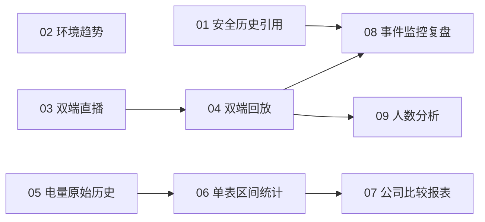

# 历史观察与视频：交付地图

日期：2026-10-09。状态：九票已发布，票01已实施并完成真实网关/微信模拟器验收，手机仍待验；见[票01交接](2026-10-09-safety-history-handoff.md)。其余票按下面发布时前置继续推进。票据拆分是已认可业务的实施粒度，不将所有未决项写成用户已批准。

票02已实施真实环境历史、PM修正与同窗口 Company 追问；手机/日期触摸/视觉复验待验，见[票02交接](2026-10-09-environment-history-handoff.md)。

票05已实施原始累计历史与同电表Company问答；真实8条记录、当前窗口保留和新目录权限验证通过，手机待验，见[票05交接](2026-10-09-meter-history-handoff.md)。票03继续推进。

票03已接立即导航、两源观看/重连、SDK释放和后端断连取消；两端真实首帧通过，微信/生产E02待验，见[实时观看交接](2026-10-09-shared-video-live-handoff.md)。票04已接双端回放准备卡、期间选择与H5模式；Company真实录像首帧2560×1440通过，Office录像首帧/手机/生产E02待验，见[回放交接](2026-10-09-shared-video-playback-handoff.md)。票08已接同一事件→Company地点候选→可调整窗口→回放/返回/引用。真实接口、模型卡片与微信操作通过，本事件摄像头解码未完成/手机/E02仍待验，见[事件复盘交接](2026-10-09-safety-camera-review-handoff.md)。06/07/09等待各自口径，不将新增门槛施加到已有历史浏览。

权威范围：[业务规格](2026-10-09-history-observation-spec.md)。接口实测、旧代码偏差和十个情境：[接入方案](2026-10-09-history-interfaces-business-integration.md)。本地 tracker 为 `.scratch/history-observation-integration/`；规格与票据正文归档 Git，tracker 只记录状态/回传并指向正文，避免因本地目录被忽略而失去实施材料。

## 九个完整闭环

| 票 | 交付与正文 | Blocked by | 局部门槛 | 发布状态 | 生产代码初估 |
|---|---|---|---|---|---|
| 01 | [三类安全历史→详情→引用](history-observation-tickets/01-safety-ledger-history.md) | None | 无 | ready-for-agent | 360–600 行 |
| 02 | [公司环境趋势→Company 追问](history-observation-tickets/02-environment-history-trends.md) | None | 颗粒物单位未知时如实显示 | ready-for-agent | 520–860 行 |
| 03 | [双端实时观看→重试→返回](history-observation-tickets/03-shared-camera-live-view.md) | None | E02 影响客户域真机关闭 | ready-for-agent | 500–880 行 |
| 04 | [录像窗口→双端回放](history-observation-tickets/04-shared-camera-playback.md) | 03 | SDK 实播证明；E02 | ready-for-agent，等 03 | 400–700 行 |
| 05 | [计量点原始历史→Company 查询](history-observation-tickets/05-meter-history-browsing.md) | None | 不输出未冻派生统计 | ready-for-agent | 400–640 行 |
| 06 | [单表区间电量→报告解释](history-observation-tickets/06-single-meter-interval-energy.md) | 05 | E01 字段/单位/倍率/边界 | needs-info | 260–440 行 |
| 07 | [公司电量对比/排名/期间报表](history-observation-tickets/07-company-energy-comparison-report.md) | 06 | E03 不重叠集合 | needs-info | 300–520 行 |
| 08 | [同一安全事件→候选监控→回放](history-observation-tickets/08-safety-event-camera-review.md) | 01、04 | 继承视频实际验收条件 | ready-for-agent，等前置 | 180–320 行 |
| 09 | [录像片段→人数分析报告](history-observation-tickets/09-recorded-video-person-count-report.md) | 04 | E04 输入/计数/准确率 | needs-info | 技术验证后估算 |

估算是开工前防止过度扩张的量级，不是新增代码额度、工期或报价；要先复核复用程度，测试和文档不机械按倍数扩写。没有“纯后端、纯 UI、测试设施、通用平台”票。为控制单票范围，原始历史与统计、直播与回放分别交付；人数分析保留为受证据约束的后续业务。

图中仅绘业务前置；E01/E02/E03/E04 的定义与影响范围见规格。编号不是强制串行队列。01/02 不依赖播放页部署，05 不依赖电量方向决定；统计 E01 和汇总 E03 不因准备结束而默认满足。

## 开工顺序与阶段界线

1. 下一条实施从 01 开始，先复现独立 smoke、混表分类和旧引用兼容的公开行为，再接微信列表/详情/引用。一次只推动一个实际闭环。
2. 02 沿已认可观察卡/仪表盘实现；不等全部视频前置或电表维修。
3. 03 开始时检查现有官方 SDK 与 H5 原型，先统一两端观看、身份和重连；04 紧接近期真实录像。SDK 回放有疑问时在独立原型分支验证，不向主线直接提交猜测模式。
4. 05 可在相应空档先交付原始历史；E01 收口后进 06，E03 后进 07。电表故障只阻断今日采样验收，不抹掉旧真实历史。
5. 01/04 完成后 08 为可独立验收的告警复盘；09 先证明提取/解码和计数规则，不把它挂在通用模型研究或框架建设上。

准备阶段已结束，当前进入逐票 implement；票01回传见上方链接。低风险只读/观看验收沿已明确范围推进；任何额外物理动作仍须具体确认。

## 交互与组件准备

现有微信单层 Sheet、局部导航栈、观察卡、SVG 图形和官方 SDK 优先复用。历史列表点击进详情、局部返回退一层、右上关闭退整层；从对话或仪表盘进入时都回实际入口。日期、类型、设备、滚动与未发送草稿保留。分析不强行使用 B6 时间轴。

按项目要求依次核对成熟方案，2026-10-09 读取官方页面：

| 优先级与一手组件链接 | 可借鉴内容 | 本项目采用方式 |
|---|---|---|
| 1：[Animate UI Sheet](https://animate-ui.com/docs/components/radix/sheet)、[Tabs](https://animate-ui.com/docs/components/animate/tabs) | 详情层开关、标题/关闭职责、受控分类切换 | 官方示例是 React；微信沿既有 DeviceSheet 和筛选控件实现相同职责，不安装这一套依赖 |
| 2：[ReUI Data Grid](https://reui.io/docs/components/base/data-grid) | 查询状态、筛选/分页与加载分离 | 官方面向 React/Tailwind；手机以常规记录列表承载，不迁入桌面数据网格的重功能 |
| 3：[shadcn Chart](https://ui.shadcn.com/docs/components/base/chart) | 指标名称、单位、图例与数据分离，固定可测高度 | 官方基于 Recharts；微信复用既有可裁切的图形承载，指标详情用普通视图；H5 此阶段只复用播放器，不新增 React 构建 |

这轮完成了组件资料核对，尚未以真实图表原型验证最终像素效果。避免为采纳库而修改项目框架；若实现时既有图形无法满足触摸读点，再为该票做一次最小兼容方案比较。

## 逐票关闭标准

- 来源、身份、窗口、字段、数量/统计覆盖及失败文案满足对应正文；旧会话和引用按原业务身份继续恢复。
- 必要公开行为回归通过；真实接口证据、微信实际操作与真机证据分别记录。视频需实际首帧/释放，统计需对照原始边界，不以 HTTP 200、截图或测试数量代替。
- 点击即有反馈，页面/详情壳先出现且返回可用；请求失败、长读或多次切选不能吞返回、覆盖新窗口或卡住全页。测量点击反馈、页面可操作、数据返回、首帧四个时间点。
- 本票必要检查后进行一次稳定切片审查；有阻断缺陷就修该闭环，其他发现登记后续，不把验收设施变成新的主线。
- 语义提交、plan 交接和本地状态回填完成；E02/E04 等外部/技术证据缺失时保留待验，不能将功能未验标成完全可用。

## 与旧工作关系

本批补充旧仪表盘统计与监控/告警接线范围，已交付的安全详情、Company/Office 任务、周期管理、站内收件箱不重做；本批未新增任务通知来源。旧父票不关闭、不重编号；本地图只维护新增九票，其号码不能与 dual-agent-automation 同号混读。
